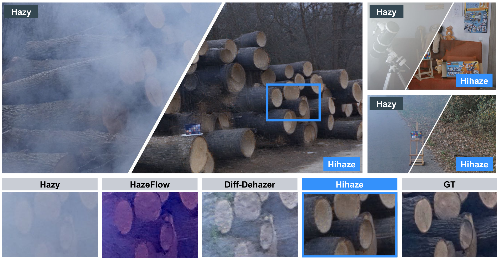
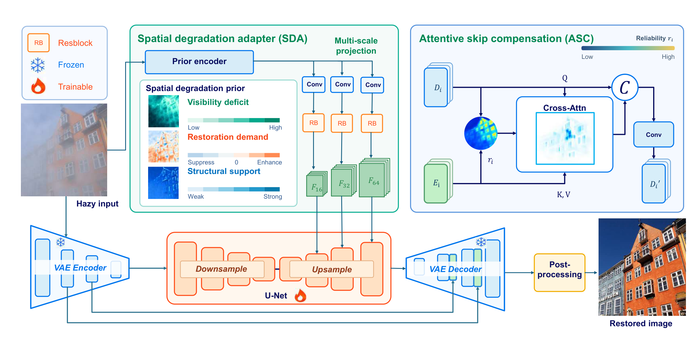
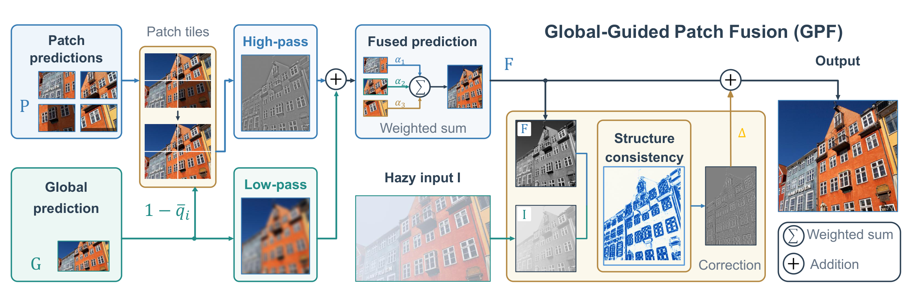
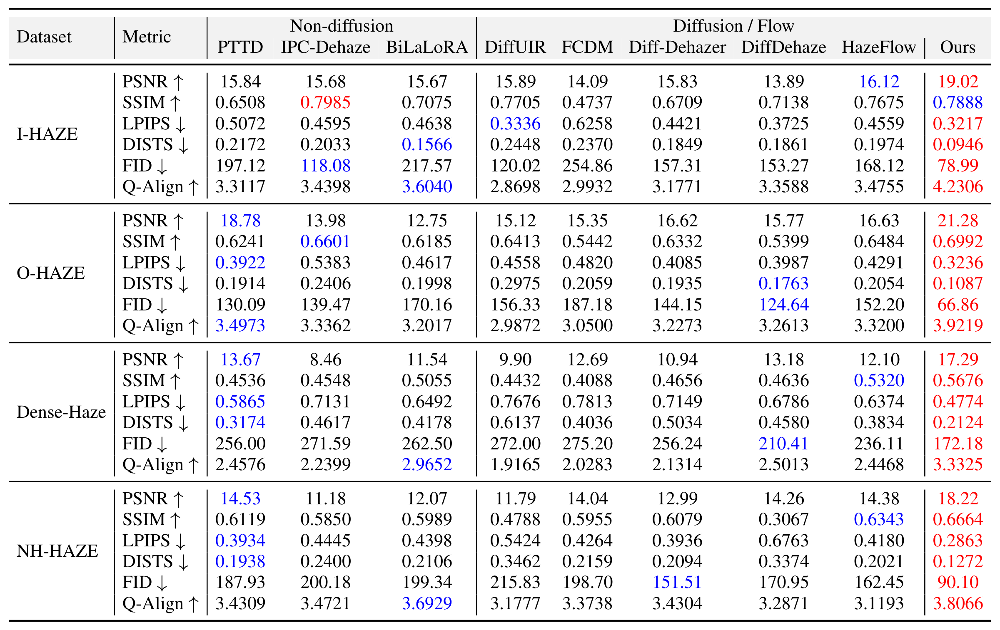
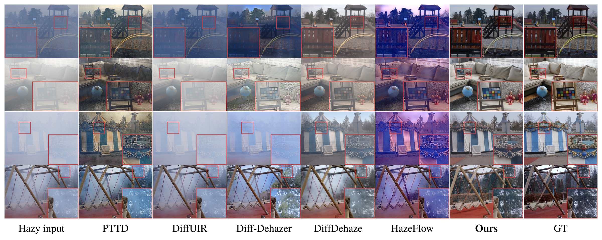
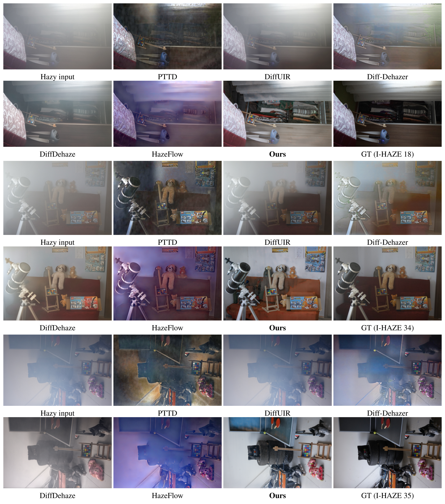
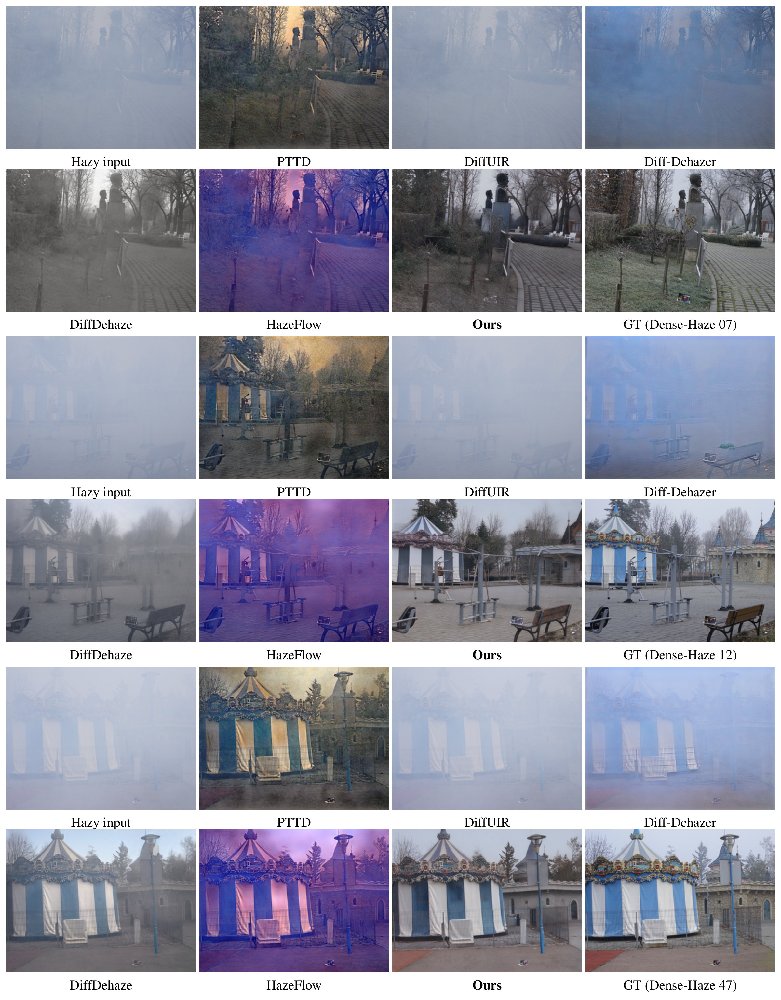
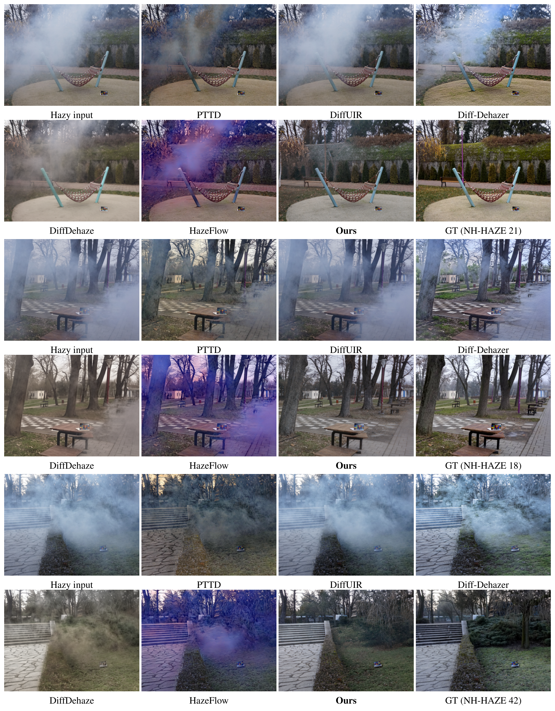

# Hihaze: One-Step Diffusion for High-Resolution Real-World Image Dehazing

[Zheng Chen](https://zheng-chen.cn/)<sup>&#42;</sup>, [Yuchen Huang](https://github.com/zhaohai200221)<sup>&#42;</sup>, [Xiaoyang Liu](https://xyliu339.github.io/), [Jue Gong](https://www.juegong.cn/), [Linghe Kong](https://www.cs.sjtu.edu.cn/~linghe.kong/), and [Yulun Zhang](https://yulunzhang.com/)<sup>†</sup>

Shanghai Jiao Tong University<br>
<sup>*</sup> Equal contribution. <sup>†</sup> Corresponding author: Yulun Zhang, [yulun100@gmail.com](mailto:yulun100@gmail.com).

<div>
<a href="https://github.com/zhengchen1999/Hihaze"></a>
<a href="https://github.com/zhengchen1999/Hihaze/stargazers"></a>
</div>


[[paper]()] [[project](https://zheng-chen.cn/Hihaze/)] [[arXiv]()]


#### 🔥🔥🔥 News

**2026-10-19:** This repo is released.

---

> **Abstract:** Diffusion models have recently achieved encouraging results in real-world image dehazing. However, restoring high-resolution images remains challenging due to spatially non-uniform haze and inconsistent predictions across local patches. To address these issues, we propose Hihaze, a one-step diffusion framework for high-resolution real-world dehazing. Hihaze adopts two haze-aware modulation modules: attentive skip compensation (ASC) and a spatial degradation adapter (SDA). ASC selectively transfers reliable encoder information to the variational autoencoder (VAE) decoder, preserving structural details while suppressing haze-degraded features. SDA extracts multi-scale spatial degradation representations and injects them into the U-Net to guide restoration according to local haze variations. Furthermore, we design a training-free global-guided patch fusion (GPF) method. It uses a global prediction to align patch appearance and downweight unreliable predictions, followed by structure-guided detail compensation. Notably, this training-free design also makes GPF a plug-and-play module for other dehazing models. Experiments across four real-world benchmarks show that Hihaze surpasses state-of-the-art approaches in both visual quality and inference speed. Specifically, it delivers PSNR improvements of **3.62 dB** on Dense-Haze and **3.69 dB** on NH-HAZE compared with the strongest baselines.



---

### Pipeline



### Global-Guided Patch Fusion



## 🔎 Results

<details open>
<summary>Quantitative Results (click to expand)</summary>

Quantitative comparisons on I-HAZE, O-HAZE, Dense-Haze, and NH-HAZE from the manuscript.

<p align="center">
  
</p>
</details>

<details open>
<summary>Qualitative Results (click to expand)</summary>

Visual comparisons on O-HAZE, I-HAZE, Dense-Haze, and NH-HAZE, from top to bottom. Red boxes mark the corresponding regions shown in the enlarged views.

<p align="center">
  
</p>

<details>
<summary>More Qualitative Results</summary>

Full-image qualitative comparisons from the supplementary material.

**O-HAZE**

<p align="center">
  
</p>

**I-HAZE**

<p align="center">
  
</p>

**Dense-Haze**

<p align="center">
  
</p>

**NH-HAZE**

<p align="center">
  
</p>
</details>
</details>

## BibTeX

```bibtex
@article{chen2026hihaze,
  title = {Hihaze: One-Step Diffusion for High-Resolution Real-World Image Dehazing},
  author = {Chen, Zheng and Huang, Yuchen and Liu, Xiaoyang and Gong, Jue and Kong, Linghe and Zhang, Yulun},
  journal = {},
  year = {2026}
}
```

## <a name="acknowledgements"></a>💡 Acknowledgements

This project builds upon [OSEDiff](https://github.com/cswry/OSEDiff) , [DINOv3](https://github.com/facebookresearch/dinov3) and [D³SR](https://arxiv.org/abs/2410.04224).
